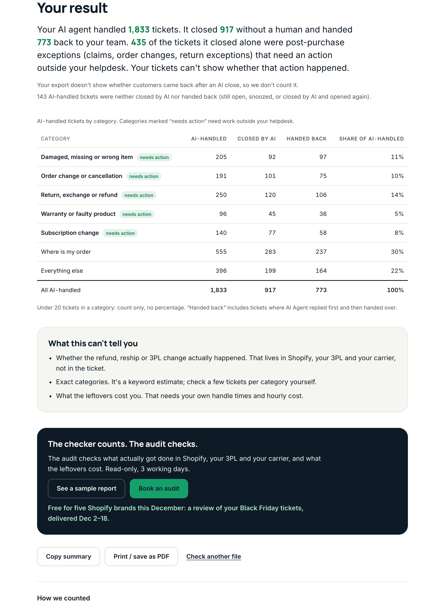

# AI support checker

Drop in a Gorgias ticket export and see how many tickets your AI agent closed on its own, how many it handed back to
your team, and how many of its closes were post-purchase exceptions (damaged, missing or wrong items, order changes,
return exceptions) that need an action outside the helpdesk.



*The screenshot uses a synthetic file from `samples/`. No real tickets are in this repo.*

## Nothing leaves your browser

The file is read and counted in your browser, in a Web Worker. There is no upload, no account, no API call, and no
analytics on the file. Only counts are ever shown: no ticket text, names, emails or order numbers.

How to check this yourself:

- **DevTools:** open the page, open DevTools → Network, then drop your file. No request appears while it's processed.
- **Offline:** load the page, turn off Wi-Fi, then drop your file. It works the same.
- **The code:** the page's Content-Security-Policy sets `connect-src 'none'`, so the browser itself blocks any
  request from page code. `test/privacy.test.js` checks the code for network calls, and the Playwright test asserts
  zero requests while a file is processed.

## Run it

**In the browser:** [closewellhq.com/check/](https://closewellhq.com/check/), or locally:

```sh
npm run build && npm run serve      # http://127.0.0.1:8788/check/
```

**From the command line** (Node 20+, no install needed):

```sh
node cli/check.js export.csv          # the same summary the page shows
node cli/check.js export.csv --json   # the counts as JSON
```

The page and the CLI share `core/`, so they give the same numbers for the same file.

How to get the export: [docs/how-to-export-from-gorgias.md](docs/how-to-export-from-gorgias.md).

## How it counts

- **AI-handled:** the ticket has a Gorgias AI Agent tag (`ai_close`, `ai_handover`, `ai_snooze`, `ai_processing`,
  `ai_answered`) or a value in the "AI Agent Outcome" ticket field. `ai_ignore` alone doesn't count.
- **Closed by AI:** `ai_close` and the ticket is closed. **Handed back:** `ai_handover` (it wins over `ai_close`).
- **Customers who came back** after an AI close aren't counted: a view export doesn't show it.
- **Categories:** keyword and tag rules on the subject, tags and contact reason; English plus basic German, French,
  Spanish and Dutch lists. A ticket gets the first match in priority order. It's an estimate.

## Change the rules

All rules live in two files:

- [`rules/gorgias.json`](rules/gorgias.json): header names and AI Agent tags.
- [`rules/categories.json`](rules/categories.json): keywords per category and language, and tags that map to a
  category.

After editing, run `npm run rules` (writes `core/rules-data.js`, which the page loads), then `npm test`. If the
results change on purpose, `npm run golden` updates the expected outputs; review the diff.

## Develop

```sh
npm test            # unit tests, golden outputs, privacy checks (Node's built-in runner)
npm run samples     # regenerate the synthetic CSVs in samples/
npm run e2e         # build + Playwright in Google Chrome: zero requests, no ticket text, page = CLI, 50,000 rows < 10 s
npm run copy-check  # words-to-avoid check on user-facing copy
```

Plain JavaScript (ES2020) with JSDoc types, no framework, no build step for the page. PapaParse is vendored in
`web/vendor/` (MIT).

## Licence

MIT, see [LICENSE](LICENSE).

Built by Closewell (closewellhq.com), which audits and finishes the post-purchase exceptions AI agents hand back.
